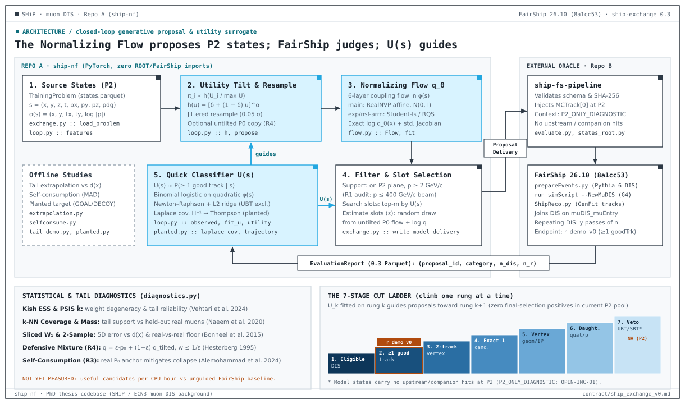

# ship-nf

Utility-guided Normalizing Flow proposal generator, surrogate classifier $U(s)$, and tail-extrapolation diagnostic suite for post-shield muon-induced Deep Inelastic Scattering (DIS) background studies in the SHiP experiment at the CERN SPS Beam Dump Facility (ECN3).

This repository implements **Repo A** of a two-repository architecture. It has **no dependency on ROOT, FairShip, or [`ship-fs-pipeline`](https://github.com/fbientrigo/ship-fs-pipeline)**. All interaction with FairShip passes through versioned, SHA-256-verified Parquet artifacts defined in [`contract/ship_exchange_v0.md`](contract/ship_exchange_v0.md) (`ship-exchange` protocol `0.3`).

---

## Problem Statement

At the SHiP experiment, a $400\;\text{GeV}/c$ SPS proton beam on target produces $\mathcal{O}(10^{11})$ muons per second. An active magnetic muon shield deflects the bulk of this flux away from the Hidden Sector Decay Spectrometer (HSDS), yet surviving muons can undergo DIS in the decay vessel walls, veto detectors, or cavern rock and mimic two-track hidden-particle decay signatures. Simulating the expected $\sim 2 \times 10^{10}$ muon DIS interactions directly is computationally prohibitive: approximately $4.5 \times 10^{6}$ simulated DIS events represent $\sim 0.02\%$ of the expected yield, scaling to $\sim 8$ CPU-years on the CERN farm at 16 h per $4.5 \times 10^{6}$ events (M. Ferrillo, 32nd SHiP CM, 2025). Earlier augmentation benchmarks reused a single input muon up to $7\,000\times$, motivating generative post-shield sampling to avoid statistical dependence and restricted phase-space coverage; while Normalizing Flow inference itself is fast ($\sim 0.58\;\text{s}$ for $4.5 \times 10^{6}$ synthetic draws on an NVIDIA L40S; Ferrillo *et al.*, 33rd SHiP CM, 2025), inference speed alone does not determine end-to-end efficiency or out-of-sample tail validity.

The central scientific question addressed by this codebase is **which post-shield muon states $s$ at the scoring plane P2 are worth evaluating in FairShip**, and how to steer generative proposals toward rare background-producing regions without silent tail failure, uncorrected estimator bias, or recursive model collapse.

---

## Architecture and Method



### State Representation and Flow Density

Each post-shield muon state $s = (x, y, z, t, p_x, p_y, p_z, \mathrm{pdg})$ recorded at the scoring plane P2 (`UpstreamTaggerScoringPlane2_2`, 10 cm downstream of the muon shield) is mapped to five continuous coordinates (`ship_nf/loop.py::features`):

$$\phi(s) = \bigl(x,\; y,\; t_x = p_x / p_z,\; t_y = p_y / p_z,\; \log |p|\bigr)$$

A 6-layer coupling Normalizing Flow (`ship_nf/flow.py`) learns an invertible map $f_\theta: \mathbb{R}^5 \to \mathbb{R}^5$ with exact density via change of variables:

$$q_\theta(x) = p_Z\bigl(f_\theta^{-1}(x)\bigr)\,\left|\det \frac{\partial f_\theta^{-1}(x)}{\partial x}\right|$$

Standardisation mean and scale are stored inside the module and included in the log-Jacobian determinant so that $\log q_\theta(x)$ is evaluated in the original feature space and densities from distinct fits remain directly comparable.

- `main` / `feat/regularization`: RealNVP affine coupling layers with $p_Z = \mathcal{N}(0, I_5)$.
- `exp/student-t-base` and `exp/nsf-arm`: controlled ablations replacing the base distribution with independent unit-variance Student-$t_5$ (`base="t5"`) and replacing affine couplings with monotonic rational-quadratic splines (`coupling="rqs"`, 8 bins on $[-5, 5]$, linear tails via `zuko`).

### Closed-Loop Utility Guidance, Exploration, and the 7-Stage Cut Ladder

At each iteration, FairShip (`FairShip 26.10`, commit `8a1cc53`, unmodified) evaluates proposed P2 states through `ship-fs-pipeline` and returns per-proposal, per-category counts $(n_{\mathrm{dis}}, n_r)$ in an `EvaluationReport` (excluding vacuum `UBT` scoring-plane DIS, which are marked `NOT_ELIGIBLE` under `dis_eligibility_v0`):

1. **Quick classifier $U(s)$ (`loop.py::fit_u`, `utility`):** Binomial logistic regression on quadratic standardised features of $\phi(s)$, fitted by Newton–Raphson with $L_2$ ridge regularisation, estimating $U(s) \approx P(\text{rung reached} \mid s)$. Each evaluated state contributes $(n_{\mathrm{dis}}, n_r)$ binomial trials rather than an unweighted average.
2. **Utility tilting (`loop.py::h`):** Source states are weighted by $\pi_i \propto h(U_i / \max_j U_j)$ with $h(u) = [\delta + (1 - \delta) u]^{\alpha}$ ($\delta > 0$ keeping every row strictly positive), resampled with $0.05\sigma$ Gaussian jitter, and used to fit $q_\theta$.
3. **Exploration–exploitation and defensive importance sampling (R4):** Because proposals are evaluated independently with no inter-state transition dynamics, sequential candidate selection is a **contextual bandit / Bayesian active search** problem rather than a full Markov decision process. Pure greedy top-$m$ selection by $U(s)$ can trap runs in local optima (e.g., states passing an early cut while failing downstream cuts). Two mechanisms are implemented and benchmarked (on `feat/regularization` and `exp/planted-target`):
   - **Defensive mixture (`--eps`, `loop.py::propose`):** Reserves a fraction $\varepsilon$ of proposal slots for unbiased random draws from an untilted flow fitted to $P_0$ with recorded $\log q$, separating *search* slots from *estimation* slots and bounding importance weights relative to the $P_0$ flow model ($w \le 1/\varepsilon$; Hesterberg 1995).
   - **Laplace Thompson sampling (`planted.py::laplace_cov`, `trajectory`):** Draws $\beta \sim \mathcal{N}(\hat{\beta}, H^{-1})$ from the Newton Hessian of the logistic fit to drive posterior-guided exploration in the low-$N_0$ regime.
4. **7-stage cut ladder:** Zero events in the current P2 training pool survive the full background selection. Rather than training on all-zero labels, $U_k(s)$ is fitted on an attainable rung and used to guide proposals toward rung $k+1$: (1) Eligible DIS $\to$ (2) $\ge 1$ good track (`r_demo_v0`, current active rung) $\to$ (3) 2-track vertex $\to$ (4) exactly 1 candidate $\to$ (5) vertex geometry and pointing $\to$ (6) daughter track quality and momentum $\to$ (7) veto survival (UBT/SBT).

---

## Empirical Findings and Guardrails

Status labels follow the project contract (`VERIFIED` / `PROVISIONAL` / `OPEN`):

| Aspect | Status | Summary and Scope |
|---|---|---|
| A↔B closed round-trip at P2 (`ship-exchange 0.3`) | **VERIFIED** | `TrainingProblem` $\to$ `MODEL_SAMPLE` $\to$ FairShip `26.10` (`8a1cc53`) $\to$ `EvaluationReport` runs end to end. Demonstration with one RealNVP $\mu^-$ ($x = 72\;\text{cm}$, $y = -18\;\text{cm}$, $|p| = 9.5\;\text{GeV}/c$, seed 2104, 20 DIS/category) yielded $45/120$ eligible DIS with $\ge 1$ `goodTracks` ($49/140$ incl. UBT); weighting 19 P2 states gave Kish ESS $= 3.6$. |
| Tail extrapolation & sample-size scaling (`afterMS`) | **VERIFIED** (on `afterMS`) | On $19\,787$ $\mu^-$ `afterMS` states (RealNVP 6 layers, width 64, 400 epochs): a centre-only flow ($|z_{p_x}| \le 2$) recovers $\approx 1\%$ of held-out tail mass ($|z_{p_x}| > 2.5$, $1\,587$ muons; $41/50\,000$ draws, $121/200\,000$ under region targeting), with sliced $W_1$ growing $3\times \to 12\times$ above the real-vs-real floor ($0.23 \to 4.6$ robust units; $p_x$ $W_1$ shift $0.3 \to 5.7\;\text{GeV}/c$ vs $0.08 \to 0.31\;\text{GeV}/c$ floor). On a 30% held-out full test split (3 seeds, $10^6$ draws), centre-only recovers $0.6\%$ ($[0.3\%, 0.9\%]$) vs $89\%$ ($[85\%, 92\%]$) for the full flow and $90\%$ size-matched; tail mass stabilises from $\sim 100$ unique tail muons and tail shape levels off around $\sim 450$ at $1.6\times$ floor. |
| Self-consumption / model collapse (`afterMS`) | **VERIFIED** (on `afterMS`) | Retraining exclusively on own synthetic draws for 5 generations drops tail coverage from $0.99$ to $0.81\text{–}0.88$; anchoring 50% real rows retains $0.95\text{–}0.98$ (`docs/density_studies.md`). |
| `afterMS` vs P2 surface | **OPEN** | Density/tail benchmarks use the legacy `afterMS` surface; the FairShip loop operates at P2 (19 rows from 3 stage-1 seeds). Claims from the two surfaces are never pooled. |
| Endpoint `r_demo_v0` vs final background | **PROVISIONAL** | Current loop targets rung 2 ($\ge 1$ `goodTracks`), not full preselection or vetoes. Model states carry no upstream/companion hits (`P2_ONLY_DIAGNOSTIC`), so UBT/SBT vetoes are `NOT_EVALUATED` (`OPEN-INC-01`). |
| Stored MC weights (`stored_mctrack_weight`) | **OPEN** | Semantics remain `OPEN` (`nominal_measure_id = null`, `permitted_use = ["PROTOCOL_TEST"]`); tilting uses equiprobable training rows (`DEC-WEIGHT-02`). |
| CPU-hour efficiency vs unguided FairShip | **OPEN** | Not yet measured. Fair-budget benchmarking (useful background candidates per CPU-hour, guided vs unguided FairShip) is the next experimental milestone. |

---

## Repository Structure and Branches

### Modules (`src/ship_nf/`)

| Module | Role | Key entry points |
|---|---|---|
| `exchange.py` | Strict `ship-exchange` 0.2/0.3 Parquet & manifest I/O | `load_problem`, `propose_resample`, `write_model_delivery`, `load_report` |
| `flow.py` | RealNVP coupling flow (plus `t5` base and `rqs` spline on `exp/nsf-arm`) | `Flow`, `Flow.log_prob`, `Flow.sample`, `fit` |
| `loop.py` | Closed-loop A step: quadratic logistic $U(s)$, tilt $h$, R4 search/estimate split | `features`, `to_state`, `observed`, `fit_u`, `utility`, `h`, `propose`, `propose_manual` |
| `diagnostics.py` | Importance-sampling and tail-fidelity diagnostics | `kish_ess`, `psis_khat`, `coverage`, `tail_mass_ratio`, `sliced_wasserstein`, `knn_two_sample_accuracy`, `error_vs_distance` |
| `extrapolation.py` | Box vs radial $\sigma$-band splits and flow error vs $k$-NN distance $d(x)$ | `pt_z`, `split`, `knn_distance`, `study`, `ab_test` |
| `selfconsume.py` | Recursive self-retraining vs real-data-anchored retraining across generations | `run`, `study` |
| `tail_demo.py` | Held-out $p_x$ tail benchmark, region targeting, and sample-size learning curve | `load`, `run`, `learning_curve` |
| `edge_reuse.py` | Pilot testing flow retraining on own tail-edge samples vs unfiltered draws | `run`, `score` |
| `planted.py` | Level-0 planted two-stage target harness (`GOAL` + `DECOY`, `R1`/`R3`/`R4`, greedy vs $\varepsilon$-mix vs Thompson; branches `exp/planted-target`, `feat/regularization`) | `trajectory`, `laplace_cov`, `grow_mask` |

### Key Branches

| Branch | Contents |
|---|---|
| `main` | Core exchange protocol, RealNVP loop, diagnostics, density studies, and meeting figures |
| `plots/cm-slides` | Slide-ready figure scripts (`plots/cm_*.py`) for the 39th SHiP Collaboration Meeting |
| `exp/planted-target` | Planted two-stage target benchmark (`src/ship_nf/planted.py`) |
| `feat/regularization` | Regularisation audit (`docs/regularization_v0.md`), R4 search/estimate split (`--eps`), Colab runner (`scripts/colab.sh`), and 39th SHiP CM materials (`docs/meeting_1121/`) |
| `exp/student-t-base` | Gaussian vs Student-$t_5$ latent base ablation on T4 (`scripts/exp_tbase.py`, `results/tbase_1120/`) |
| `exp/nsf-arm` | Monotonic rational-quadratic spline coupling (`zuko`, `coupling="rqs"`) ablation (`results/nsf_1120/`) |

---

## Installation and Usage

Requires Python $\ge 3.11$ and [`uv`](https://docs.astral.sh/uv/). PyTorch CPU wheels are configured via `pyproject.toml`.

```sh
uv sync --extra flow                       # core + numpy, scipy, torch (CPU)
uv sync --extra flow --extra fig           # add matplotlib for plots/
# On branch exp/nsf-arm:
uv sync --extra flow --extra nsf           # add zuko==1.6.0 for RQS splines
```

Run tests directly with the virtual environment interpreter (avoid bare `uv run` without extras):

```sh
.venv/bin/python -m pytest -q
```

### Core CLI Commands

```sh
# Inspect a TrainingProblem published by ship-fs-pipeline
.venv/bin/python -m ship_nf inspect TRAINING_PROBLEM_DIR

# Protocol 0.2 baseline (EMPIRICAL_RESAMPLE, not a model)
.venv/bin/python -m ship_nf propose TRAINING_PROBLEM_DIR --out delivery/ --n 50 --seed 0

# Closed-loop A step (MODEL_SAMPLE delivery; --eps R4 estimation slots on feat/regularization)
.venv/bin/python -m ship_nf propose-nf TRAINING_PROBLEM_DIR --out delivery/ --m 5 --seed 0 \
    --history iter0/delivery iter0/report

# Offline density, tail-extrapolation, and learning-curve benchmarks (afterMS .npz sample)
.venv/bin/python -m ship_nf extrapolation  AFTERMS.npz --out ab_extrapolation.json
.venv/bin/python -m ship_nf selfconsume    AFTERMS.npz --out selfconsume.json
.venv/bin/python -m ship_nf tail-demo      AFTERMS.npz --out tail_demo_out/
.venv/bin/python -m ship_nf learning-curve AFTERMS.npz --out learning_curve_out/

# Level-0 planted-target benchmark (branch feat/regularization)
.venv/bin/python -m ship_nf.planted planted_out.json --seeds 10 --iters 20 --workers 4

# Regenerate docs/figures/architecture.svg (Python standard library only)
python3 plots/make_architecture_svg.py
```

The end-to-end driver alternating `ship-nf` and FairShip lives in the companion repository [`ship-fs-pipeline`](https://github.com/fbientrigo/ship-fs-pipeline) (`scripts/demo_loop.sh`). `tests/fixtures/training_problem` is a `TrainingProblem` published by Repo B (FairShip `8a1cc53`, seeds 201–203) and verified by Repo B's cross-repo interoperability tests; each `afterMS` study records its input `.npz` path and SHA-256 digest. Detailed technical notes are in [`docs/density_studies.md`](docs/density_studies.md), [`docs/meeting_1121.md`](docs/meeting_1121.md), and (on branch `feat/regularization`) `docs/regularization_v0.md`.

---

## References

### SHiP Experiment, ECN3 Background Studies, and Generative Muon Simulation
- S. Alekhin *et al.*, *"A facility to Search for Hidden Particles at the CERN SPS: the SHiP physics case"*, *Rep. Prog. Phys.* **79**(12), 124201 (2016), doi:[10.1088/0034-4885/79/12/124201](https://doi.org/10.1088/0034-4885/79/12/124201), [arXiv:1504.04855](https://arxiv.org/abs/1504.04855).
- M. Anelli *et al.* (SHiP Collaboration), *"A facility to Search for Hidden Particles (SHiP) at the CERN SPS"*, CERN-SPSC-2015-016 / SPSC-P-350 (2015), [arXiv:1504.04956](https://arxiv.org/abs/1504.04956).
- A. Akmete *et al.* (SHiP Collaboration), *"The active muon shield in the SHiP experiment"*, *JINST* **12**, P05011 (2017), doi:[10.1088/1748-0221/12/05/P05011](https://doi.org/10.1088/1748-0221/12/05/P05011), [arXiv:1703.03612](https://arxiv.org/abs/1703.03612).
- C. Ahdida *et al.* (SHiP Collaboration), *"Fast simulation of muons produced at the SHiP experiment using Generative Adversarial Networks"*, *JINST* **14**, P11028 (2019), doi:[10.1088/1748-0221/14/11/P11028](https://doi.org/10.1088/1748-0221/14/11/P11028), [arXiv:1909.04451](https://arxiv.org/abs/1909.04451).
- C. Ahdida *et al.* (SHiP Collaboration), *"The SHiP experiment at the proposed CERN SPS Beam Dump Facility"*, *Eur. Phys. J. C* **82**, 469 (2022), [arXiv:2112.01487](https://arxiv.org/abs/2112.01487).
- SHiP Collaboration, *"BDF/SHiP at the ECN3 high-intensity beam facility — Technical Proposal"*, CERN-SPSC-2023-033 / SPSC-P-369 (2023), [CDS 2878604](https://cds.cern.ch/record/2878604); SHiP Collaboration & HI-ECN3 Project Team, *"SHiP experiment at the SPS Beam Dump Facility"*, [arXiv:2504.06692](https://arxiv.org/abs/2504.06692) (2025).
- I. Bezshyiko, O. Lantwin, M. Ovchynnikov, and A. Reghunath, *"Signal and Background Studies for ECN3"*, SHiP internal note CERN-SHiP-INT-2024-001 (Oct 2024), [CDS 2912101](https://cds.cern.ch/record/2912101).
- M. Ferrillo, *"Search for Hidden Particles at the SPS ECN3 High-Intensity Beam Facility"*, Annual Meeting of the Swiss Physical Society, ETH Zürich, 11 Sep 2024, [Indico](https://indico.cern.ch/event/1382917/contributions/6028599/).
- M. Ferrillo, *"Plans for Generating Large Muon Background Samples"*, 32nd SHiP Collaboration Meeting, CERN, 13 Mar 2025.
- M. Ferrillo, M. Borisyak, O. Lantwin, N. Serra, and A. Ustyuzhanin, *"Augmented Muon Background Simulation with Normalising Flows"*, 33rd SHiP Collaboration Meeting, 5 Jun 2025.
- O. Lantwin (SHiP Collaboration), *"Towards the Future SHiP Simulation Framework and Geometry"*, 28th Conference on Computing in High Energy and Nuclear Physics (CHEP 2026), 27 May 2026, [Indico](https://indico.cern.ch/event/1471803/contributions/6967961/).

### Normalizing Flows, Tail Expressivity, and Neural Importance Sampling
- D. J. Rezende and S. Mohamed, *"Variational Inference with Normalizing Flows"*, *Proc. 32nd ICML*, PMLR **37**, 1530–1538 (2015), [arXiv:1505.05770](https://arxiv.org/abs/1505.05770).
- L. Dinh, J. Sohl-Dickstein, and S. Bengio, *"Density estimation using Real NVP"*, *ICLR* (2017), [arXiv:1605.08803](https://arxiv.org/abs/1605.08803).
- C. Durkan, A. Bekasov, I. Murray, and G. Papamakarios, *"Neural Spline Flows"*, *NeurIPS* (2019), [arXiv:1906.04032](https://arxiv.org/abs/1906.04032).
- T. Müller, B. McWilliams, F. Rousselle, M. Gross, and J. Novák, *"Neural Importance Sampling"*, *ACM Trans. Graph.* **38**(5), Article 145 (2019), [arXiv:1808.03856](https://arxiv.org/abs/1808.03856).
- C. Gao, S. Höche, J. Isaacson, C. Krause, and H. Schulz, *"Event Generation with Normalizing Flows"*, *Phys. Rev. D* **101**, 076002 (2020), [arXiv:2001.10028](https://arxiv.org/abs/2001.10028).
- P. Jaini, I. Kobyzev, Y. Yu, and M. Brubaker, *"Tails of Lipschitz Triangular Flows"*, *ICML* (2020), [arXiv:1907.04481](https://arxiv.org/abs/1907.04481).
- G. Papamakarios, E. Nalisnick, D. J. Rezende, S. Mohamed, and B. Lakshminarayanan, *"Normalizing Flows for Probabilistic Modeling and Inference"*, *J. Mach. Learn. Res.* **22**(57), 1–64 (2021), [arXiv:1912.02762](https://arxiv.org/abs/1912.02762).
- F. Rozet *et al.*, *"Zuko: Normalizing flows in PyTorch"*, Zenodo, doi:[10.5281/zenodo.10064295](https://doi.org/10.5281/zenodo.10064295).

### Adaptive Importance Sampling, Diagnostics, and Self-Consuming Loops
- L. Kish, *Survey Sampling*, John Wiley & Sons, New York (1965).
- T. Hesterberg, *"Weighted Average Importance Sampling and Defensive Mixture Distributions"*, *Technometrics* **37**(2), 185–194 (1995).
- J. Zhang and M. A. Stephens, *"A New and Efficient Estimation Method for the Generalized Pareto Distribution"*, *Technometrics* **51**(3), 316–325 (2009).
- A. B. Owen, *Monte Carlo Theory, Methods and Examples* (2013), Ch. 9 (*Importance Sampling*).
- N. Bonneel, J. Rabin, G. Peyré, and H. Pfister, *"Sliced and Radon Wasserstein Barycenters of Measures"*, *J. Math. Imaging Vis.* **51**, 22–45 (2015).
- M. F. Bugallo, V. Elvira, L. Martino, D. Luengo, J. Míguez, and P. M. Djurić, *"Adaptive Importance Sampling: The Past, the Present, and the Future"*, *IEEE Signal Process. Mag.* **34**(4), 60–79 (2017).
- Y. Yao, A. Vehtari, D. Simpson, and A. Gelman, *"Yes, but Did It Work?: Evaluating Variational Inference"*, *ICML*, PMLR **80** (2018), [arXiv:1802.02538](https://arxiv.org/abs/1802.02538).
- M. F. Naeem, S. J. Oh, Y. Uh, Y. Choi, and J. Yoo, *"Reliable Fidelity and Diversity Metrics for Generative Models"*, *ICML*, PMLR **119**, 7176–7185 (2020), [arXiv:2002.09797](https://arxiv.org/abs/2002.09797).
- V. Elvira, L. Martino, and C. P. Robert, *"Rethinking the Effective Sample Size"*, *Int. Stat. Rev.* **90**(3), 525–550 (2022), [arXiv:1809.04129](https://arxiv.org/abs/1809.04129).
- A. Vehtari, D. Simpson, A. Gelman, Y. Yao, and J. Gabry, *"Pareto Smoothed Importance Sampling"*, *J. Mach. Learn. Res.* **25**(72), 1–58 (2024), [arXiv:1507.02646](https://arxiv.org/abs/1507.02646).
- S. Alemohammad *et al.*, *"Self-Consuming Generative Models Go MAD"*, *ICLR* (2024), [arXiv:2307.01850](https://arxiv.org/abs/2307.01850).
- I. Shumailov, Z. Shumaylov, Y. Zhao, N. Papernot, R. Anderson, and Y. Gal, *"AI models collapse when trained on recursively generated data"*, *Nature* **631**(8022), 755–759 (2024), doi:[10.1038/s41586-024-07566-y](https://doi.org/10.1038/s41586-024-07566-y).

### Reinforcement Learning, Contextual Bandits, and Active Search
- W. R. Thompson, *"On the likelihood that one unknown probability exceeds another in view of the evidence of two samples"*, *Biometrika* **25**(3/4), 285–294 (1933).
- O. Chapelle and L. Li, *"An Empirical Evaluation of Thompson Sampling"*, *NeurIPS* (2011).
- R. Garnett, Y. Krishnamurthy, X. Xiong, J. Schneider, and R. Mann, *"Bayesian Optimal Active Search and Surveying"*, *ICML* (2012), [arXiv:1206.6406](https://arxiv.org/abs/1206.6406).
- R. S. Sutton and A. G. Barto, *Reinforcement Learning: An Introduction*, 2nd ed., The MIT Press (2018).
- D. J. Russo, B. Van Roy, A. Kazerouni, I. Osband, and Z. Wen, *"A Tutorial on Thompson Sampling"*, *Found. Trends Mach. Learn.* **11**(1), 1–96 (2018), doi:[10.1561/2200000070](https://doi.org/10.1561/2200000070), [arXiv:1707.02038](https://arxiv.org/abs/1707.02038).

---

## Acknowledgements

PhD thesis research by Fabián Trigo (ULS / UV / UTA), supported by ANID FONDECYT Regular Grants No. 1262417, 1241803, and 1241685. Supervision by Orlando Soto (ULS); FairShip guidance by Oliver Lantwin; post-shield muon samples and muon-DIS background groundwork by Martina Ferrillo.
